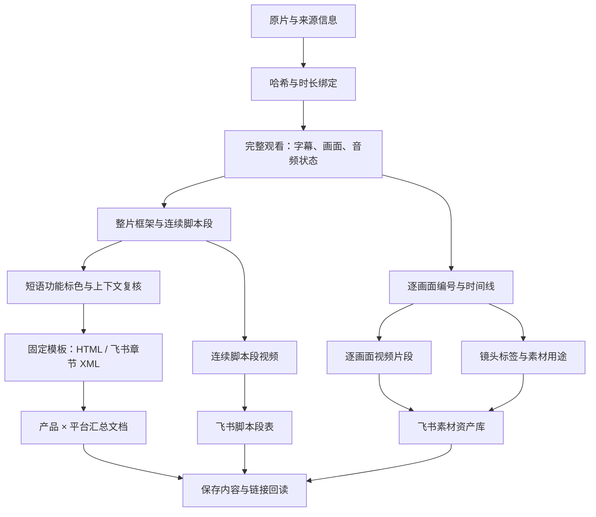

# 项目全貌

目标是把一个视频整理成可追溯、可复刻、可找回的脚本和素材。
核心分析由执行者结合原片完成；程序负责约束数据、排版、切片、同步和验收。

## 两类交付

| 层级 | 用途 | 必须保留 |
| --- | --- | --- |
| 整片 / 连续脚本段 | 看懂结构，复刻表达 | 原文、时间、标色、原片公式、可替换变量、情绪证据、拍法 |
| 逐画面素材 | 检索和调用片段 | 画面编号、起止时间、源视频、脚本段归属、视频附件、标签、复用判断 |

一个视觉切点不等于一个新脚本段。先按意思形成连续脚本段，再将对应镜头归组。
同一镜头可覆盖两个语义段的边界，交集关系由时间线校验，不靠顺序猜测。

## 数据身份

- `source_id` 和源文件 SHA-256 绑定实际视频；标题不是唯一键。
- 产品归档身份与原片实际品牌分开，不把竞品自动写成本品体验。
- 平台是来源元数据；支持平台标签不代表实现了该平台下载器。
- 文档注册表使用 Base、产品、平台组成的稳定组键，组内按视频身份更新章节。
- 远端记录 ID、章节锚点和上传日志是项目状态，不能写进可分发 Skill。

## 模块分工

| 模块 | 主要文件 | 负责什么 |
| --- | --- | --- |
| 本地入口 | `scripts/project.py` | 初始化、依赖检查、合成演示、安装 Skill |
| 分析合约 | `validate_script_v3.py`、`validate_section_content.py` | 脚本段连续性、镜头交集、段级证据 |
| 标色与复核 | `phrase_annotation.py`、`context_review.py`、`publication_review.py` | 字符区间、功能标签、语境记录、来源与审核哈希 |
| 展示 | `render_script_analysis.py`、`render_platform_chapter.py` | 统一 HTML 和 H1/H2 / 逐字样式 |
| 媒体 | `export_reviewed_timeline.py`、`export_script_v3.py` | 已审时间线导出、真实媒体探测、解码校验、恢复执行 |
| 证据帧 | `extract_interval_evidence.py` | 按真实 PTS 取帧，避免把请求时间当实际帧时间 |
| 飞书适配 | `build_video_base_plan.py`、`sync_video_base.py` | 显式配置、可审阅计划、串行写入、附件和关联回读 |
| 文档更新 | `publish_platform_chapter.py`、`repair_platform_chapter.py` | 按现有注册章节更新，保留其他视频和人工修改 |
| 素材验收 | `verify_material_gallery.py` | 附件、产品平台归属、画廊过滤、关联与视频封面 |
| 可选扩展 | PNG、ASR、素材复用与 AI 任务参考 | 需要时启用；不等同于生成视频服务 |
| 旧模板 | `legacy-folder-workflow.md` | 显式选择的 27 字段链，不作为新项目默认值 |

除根目录入口外，上表脚本均位于 `skill/analyze-folder-videos-to-feishu/scripts/`。

## 从项目专版剥离了什么

可分发：Skill、通用程序、参考规范、占位配置、独立合成样例、回归测试。

留在原项目：实际表格与文档配置、所有者映射、视频索引、发布注册表、任务现场、
原片和切片、音频、截图、标注与审阅记录、历史修复脚本、认证与模型文件。

原项目可以继续拆解；新仓库用于维护通用能力。升级旧项目时先备份可恢复的配置与状态，
在独立样例中验证兼容，再替换 Skill。不要用空白初始化覆盖旧注册表。

## 自动化边界

程序可以证明字符未被改写、时间线相交、附件存在、H2 正确、内容已回读。
它不能单独证明颜色含义合理、脚本听写正确、情绪推断成立或镜头适合投放。
这些需要原片审阅与独立复核，记录为与结构检查分开的结论。

新 Base 的表与视图、产品平台目录、文档创建和权限交接，需要根据实时接口由执行者
完成初始化；仓库不冒充无人值守的全平台下载、分析、发布或 AI 生成产品。
